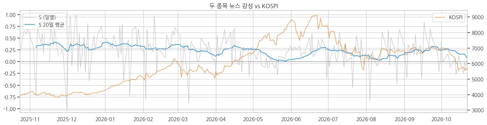

# 뉴스 감성으로 매매하면 안 되는 이유: 실습 결과에서 출발한 추론

결과 그래프를 보며 정리한 추론 노트다. 검증된 사실, 그래프에서 읽은 관찰, 실전 경험에서 온 가설을 구분해서 적는다.

## 1. 출발점: 실습에서 확인된 사실

삼성전자·SK하이닉스 관련 매일경제 기사 2,899건(2025-10-23～2026-10-23)에 감성 점수 S(P긍정 − P부정)를 매기고, 다음 거래일 수익률과의 관계를 241거래일 표본 외로 평가했다.

- 신호 2종 × 수익률 6종, 12개 조합의 상관계수가 **모두 음수**(−0.015～−0.110)였다. 다만 t값 절댓값은 최대 1.67로 유의하지 않다.
- 감성이 가장 낮았던 1분위의 다음 날 KOSPI 수익률이 가장 높았다(+77bp).
- ΔS > 0일 때 매수하는 전략은 비용 차감 후 모두 단순 보유를 밑돌았다.
- 페어(삼성 − 하닉 상대 감성)도 신호가 없었다.

즉 "긍정 뉴스 → 매수"는 작동하지 않았고, 부호만 보면 오히려 반대 방향이었다.

## 2. 그래프에서 읽은 것



**고점 부근의 긍정 뉴스는 가격을 뒤따라 나왔다.** 5월 말 S 20일 평균은 0 근처였다가, KOSPI가 9,000선 고점을 찍는 6월 중순～말에 0.25～0.3까지 올라간다. 그런데 20일 평균의 꼭지는 KOSPI 고점보다 늦은 7월 초이고, 지수가 꺾여 내려오는 동안에도 한동안 높게 유지된다. 고점을 예고한 신호가 아니라 오른 가격을 설명하는 기사가 뒤늦게 쌓인 모양이다.

**감성이 가장 좋았던 때는 바닥이었다.** S 20일 평균은 KOSPI가 4,000선에 머물던 2025년 11월～2026년 1월에 0.35～0.4로 가장 높았다.

**급등 구간에서는 감성이 오히려 나빠졌다.** 4～5월 KOSPI가 가장 가파르게 오르는 동안 S 20일 평균은 0.27에서 0.05 근처까지 떨어졌다. 실습 정리에 따르면 이 시기 노조·성과급 관련 기사가 많았다. 감성 모델 입장에서는 부정적인 기사지만 주가 방향과는 거의 무관한 뉴스다.

> 위 관찰은 그래프를 눈으로 읽은 것이고 수치로 검증하지 않았다. 검증 방법은 5절에 적었다.

## 3. 추론: 뉴스를 긍정·부정으로 평가하고 매매하는 것 자체가 오류다

2절의 세 장면은 같은 이야기를 한다.

**첫째, 뉴스는 가격의 원인이 아니라 해설인 경우가 많다.** 오르면 오른 이유를 쓰고, 내리면 내린 이유를 쓴다. 해설 기사의 톤을 신호로 쓰면 결국 이미 일어난 가격 움직임을 늦게 추종하게 된다. 고점 부근에서 감성이 뒤늦게 올라간 것이 그 예다.

**둘째, 기사의 톤과 가격 영향력은 다른 축이다.** 노조·성과급 기사는 톤으로는 부정이지만 실적 경로를 바꾸지 않는다. 감성 모델은 문장의 기분을 읽을 뿐, 그 뉴스가 이익 추정치를 얼마나 바꾸는지는 모른다. 그래서 급등 구간에 감성이 바닥으로 가는 일이 생긴다.

**셋째, 반응은 이미 가격에 들어가 있다.** 이 구간 KOSPI는 종가→종가 +31%, 시가→종가 −20%였다. 상승 대부분이 밤사이 갭에서 나왔다는 뜻이고, 다음 날 아침 기사를 읽고 들어가는 시점에는 반응이 끝나 있다.

이 세 가지 때문에 "긍정이면 사고 부정이면 판다"는 규칙은 구조적으로 늦거나, 엉뚱한 뉴스에 반응하게 된다. 실습에서 상관계수 부호가 일관되게 음수로 나온 것도 이 해석과 맞는다.

## 4. 가설: SNS는 더 심하다, 그리고 예외는 실적 돌파뿐이다

여기부터는 실습 데이터가 아니라 **실전 경험에서 온 가설**이다. 실습은 신문 기사만 다뤘고 SNS 데이터는 쓰지 않았다.

### 4-1. SNS 언급량이 많아질수록 파는 쪽이 정답일 때가 많다

신문 기사가 가격을 뒤따라간다면, SNS는 그보다 더 늦게, 더 크게 따라간다. 언급량이 폭증하는 시점은 대개 이미 크게 오른 뒤이고, 그때 새로 들어오는 자금은 마지막 매수자일 가능성이 높다. 학계의 주의(attention) 효과 연구, 즉 관심이 몰린 종목에 개인 자금이 들어온 뒤 수익률이 정체된다는 결과와도 방향이 같다.

이때 신호는 **톤이 아니라 양**이다. 긍정인지 부정인지 판정할 필요 없이, 평소 대비 언급량이 얼마나 튀었는지가 과열의 척도가 된다.

### 4-2. 유일한 예외: 실적 돌파가 막 시작됐을 때

예외는 하나다. **실적 컨센서스가 매우 강하게 상향되고, 그 상향이 시작된 지 얼마 안 됐을 때.**

이 경우는 뉴스가 해설이 아니라 이익 추정치 자체가 바뀌는 사건이다. 컨센서스 상향은 한 번에 끝나지 않고 몇 달에 걸쳐 이어지는 경향이 있어서, 초기에는 가격이 아직 그 경로를 다 반영하지 못한다. 언급량 증가가 과열이 아니라 재평가의 시작일 수 있는 구간이다.

핵심 구분은 두 가지다.

| 구분 | 매도 쪽(일반 규칙) | 예외(실적 돌파) |
| --- | --- | --- |
| 뉴스의 성격 | 해설·화제성·이슈 | 이익 추정치 변경 |
| 시점 | 언급량이 이미 폭증한 뒤 | 컨센서스 상향 초기 |

같은 "언급량 급증"이라도 그 밑에 컨센서스 상향이 있는지, 그 상향이 몇 번째인지에 따라 판단이 반대가 된다.

## 5. 다음에 검증할 것

아래는 아직 실행하지 않은 검증 계획이다.

**① 감성은 가격을 선행하는가, 후행하는가.** 노트북 `Part 4-2` 셀 다음에 시차 상관을 찍는다. 양수 lag 쪽 상관이 크면 감성이 후행한다는 2절의 관찰이 수치로 확인된다.

```python
S_ma20 = sig['S'].rolling(20, min_periods=10).mean()
kospi_close = px['KOSPI']['Close'].reindex(cal)
ret20 = kospi_close.pct_change(20)

# lag > 0: 과거 가격 vs 현재 감성 (감성 후행)
# lag < 0: 미래 가격 vs 현재 감성 (감성 선행)
for lag in range(-20, 21, 5):
    print(f"lag {lag:+3d}: {S_ma20.corr(ret20.shift(lag)):+.2f}")
```

**② 톤 대신 양.** 감성 점수 대신 기사 수 `sig['n']`의 과거 20일 평균 대비 배수를 신호로 놓고, 배수가 높은 날 이후 20거래일 수익률이 낮은지 본다. SNS 데이터가 없으므로 우선 신문 기사 수로 4-1 가설의 약한 버전을 시험한다.

**③ 예외 조건 분리.** 언급량 급증일을 컨센서스 상향 여부(예: 최근 1～3개월 영업이익 추정치 변화율)로 나눠, 상향 초기 구간에서만 이후 수익률이 양수로 바뀌는지 본다. 컨센서스 데이터 확보가 선행돼야 한다.

**주의.** 실습에서 무작위 신호로도 t값 −2.4가 나왔다. 조합을 많이 시험할수록 우연히 좋은 결과가 나오므로, 단일 t값보다 반기별 부호 지속성과 분위별 단조성을 함께 확인한다.

## 6. 한 줄 요약

뉴스와 SNS는 가격을 설명할 뿐 예측하지 않는다. 톤으로 매매하면 늦고, 언급량이 폭증하면 오히려 팔 때다. 단, 실적 컨센서스가 강하게 막 상향되기 시작한 경우만은 예외다.

참고 글:
https://wejumplabs.com/entry/AI%EA%B0%80-%EB%89%B4%EC%8A%A4%EB%A5%BC-%EC%9A%94%EC%95%BD%ED%95%B4%EC%A4%98%EB%8F%84-%EC%A3%BC%EC%8B%9D-%EC%88%98%EC%9D%B5%EC%9D%B4-%EC%95%88-%EB%82%98%EB%8A%94-%EC%9D%B4%EC%9C%A0

https://wejumplabs.com/entry/AI%EA%B0%80-%EB%89%B4%EC%8A%A4%EB%A5%BC-%EB%8B%A4-%EC%9D%B4%ED%95%B4%ED%95%B4%EB%8F%84-%EC%A3%BC%EC%8B%9D-%EC%88%98%EC%9D%B5%EC%9D%B4-%EC%95%88-%EB%82%98%EB%8A%94-%EC%9D%B4%EC%9C%A0-LLM-%ED%80%80%ED%8A%B8-%ED%88%AC%EC%9E%90%EC%9D%98-%ED%95%9C%EA%B3%84%EC%99%80-%EC%8B%A4%EC%A0%84
